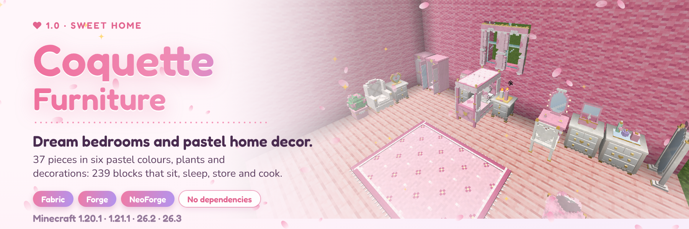

**[Discord](https://discord.gg/TJc3CxR4jK) · [Source and issues](https://github.com/MeherBenSalem/Coquette-Furniture)**

## Dream bedrooms and pastel home decor.

**Coquette Furniture** fills your builds with **37 pieces of furniture in six pastel colourways**, **4 potted plants** and **13 decorations**: 239 blocks in all. Each one is a detailed model with cabriole legs, gold knobs, satin bows, lace trims, tufted cushions and hearts.

Most of them do something too. **Sit** on sofas and swings, **sleep** in a canopy bed, **store** things in wardrobes and fridges, **cook** on the stove, run a **bubble bath**, fill buckets at the sink, light candles, play a music box or get pampered at the vanity. Browse it all in the **Interior Design Catalog**, and repaint any placed piece with a dye.

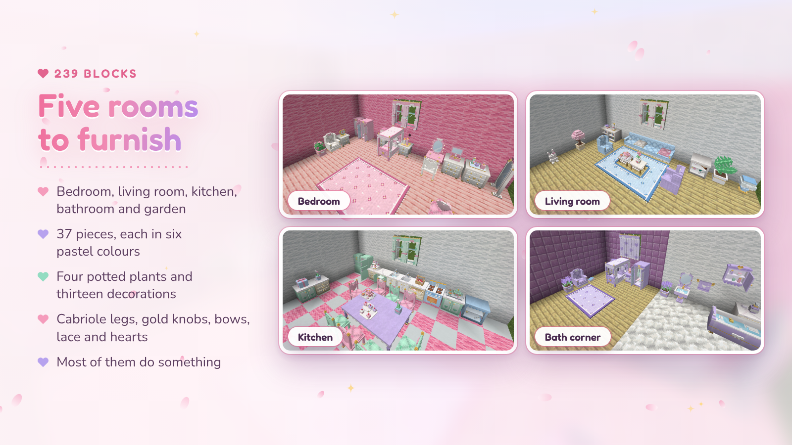

Every piece below comes in all six colours: **Baby Pink, White, Cream, Lavender, Mint and Baby Blue**.

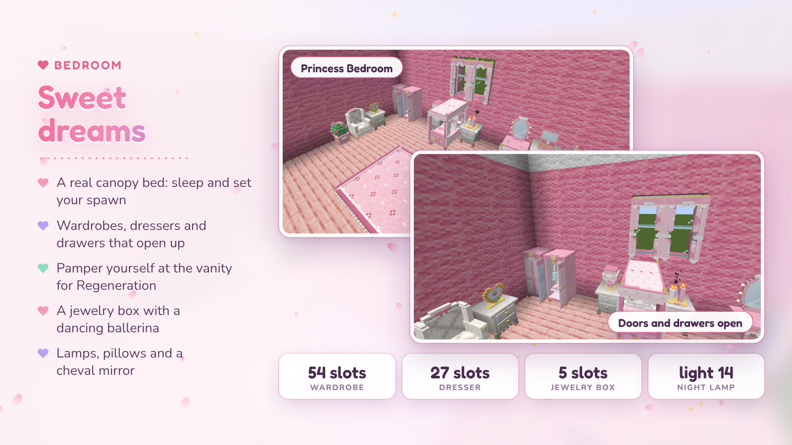

| Piece | What it does |
| --- | --- |
| **Canopy Bed** | A real bed: sleep through the night, set your spawn. Four posts, a sheer canopy with a scalloped valance and drapes tied with bows |
| **Decorative Pillows** | Stack up to 3 and sit on them. Toss them onto a bed, sofa or chair and they settle onto it |
| **Bedside Table** | 9-slot drawer that slides out while it's open. Decorations sit on top |
| **Wardrobe** | Two blocks tall with 54 slots. The doors swing open on hanging dresses and a mirror |
| **Dresser** | 27 slots; a drawer of folded clothes slides out |
| **Vanity Table** | Right-click to **pamper yourself**: a compliment, sparkles and 10 seconds of Regeneration. Sneak and right-click for its drawer |
| **Standing Mirror** | A two-block cheval mirror that pays you a compliment |
| **Jewelry Box** | 5 slots. The lid opens on a mirror and a tiny ballerina while it plays *Für Elise* |
| **Night Lamp** | Light level 14; switch it on and off |

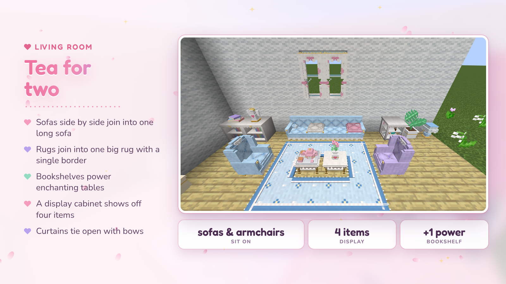

| Piece | What it does |
| --- | --- |
| **Sofa** | Sit. Sofas side by side **join into one long sofa** with arms only at the ends |
| **Armchair** | A tufted wingback armchair. Sit |
| **Coffee Table** | A low table with a book shelf. Decorations sink down to stand on it |
| **Bookshelf** | Powers enchanting tables like a vanilla bookshelf |
| **Display Cabinet** | Put any item on one of its 4 glass shelves and it slowly turns on display |
| **Rug** | Neighbouring rugs of the same colour **join into one big rug** with a single lace-fringed border |
| **Curtains** | Two blocks tall and hung on a wall. Tie them open with bows or let them fall closed. Walk-through |

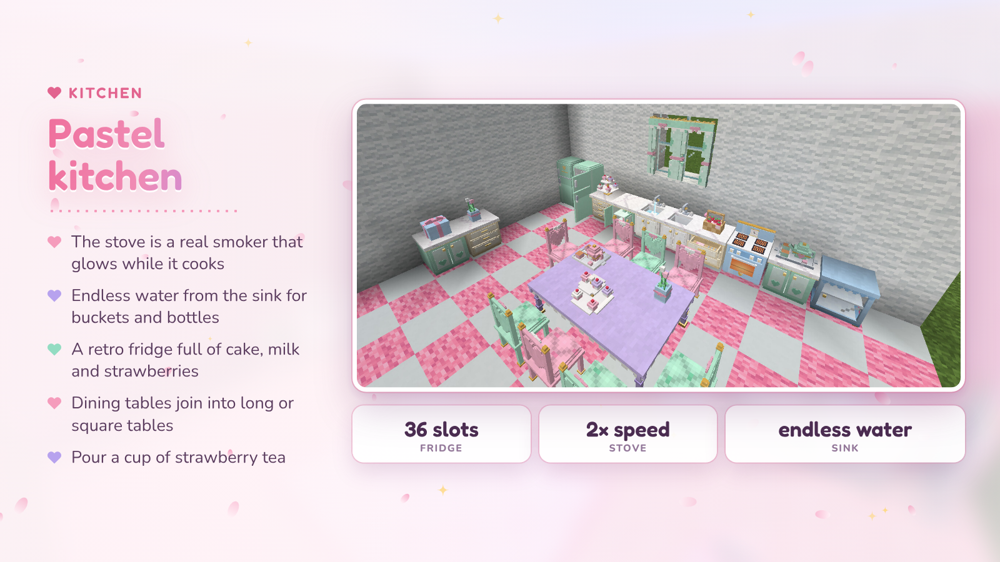

| Piece | What it does |
| --- | --- |
| **Kitchen Cabinet** | 18 slots; the doors open on plates, jars and teacups |
| **Refrigerator** | A two-block retro fridge with 36 slots. Both doors open on cake, milk and strawberries |
| **Kitchen Counter** | 18 slots; the top drawer slides out with utensils and a rolling pin |
| **Kitchen Sink** | **Endless water** for buckets and bottles. Turn the tap on for running water |
| **Stove** | A real smoker: cooks food twice as fast. The burners and oven window glow while it cooks |
| **Dining Table** | Joins with its neighbours into **long or square tables**, with legs and lace only on the outside |
| **Dining Chair** | A heart-backed chair. Sit |
| **Tea Set** | Use a glass bottle on it to pour a **Cup of Strawberry Tea** (a snack with a little Regeneration; you keep the bottle) |

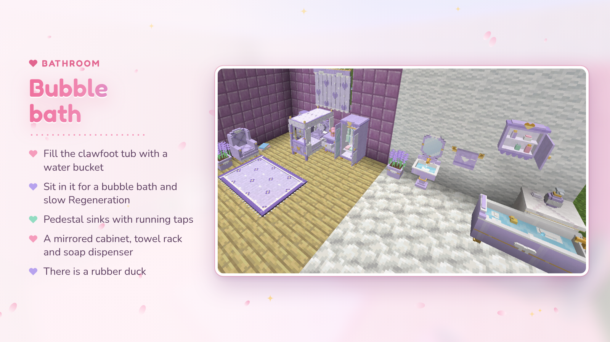

| Piece | What it does |
| --- | --- |
| **Bathtub** | A two-block clawfoot tub with a rubber duck. Fill it with a water bucket, then sit in it for a **bubble bath** with slow Regeneration |
| **Bathroom Sink** | A pedestal sink with the same endless water and tap |
| **Wall Mirror** | An oval wall mirror that pays you a compliment |
| **Bathroom Cabinet** | Wall-mounted, 9 slots; the mirrored door swings open on perfume bottles |
| **Towel Rack** | A wall-mounted towel with a lace hem and an embroidered heart |
| **Soap Dispenser** | Bubbles and squeaky clean hands (it also puts out fire) |

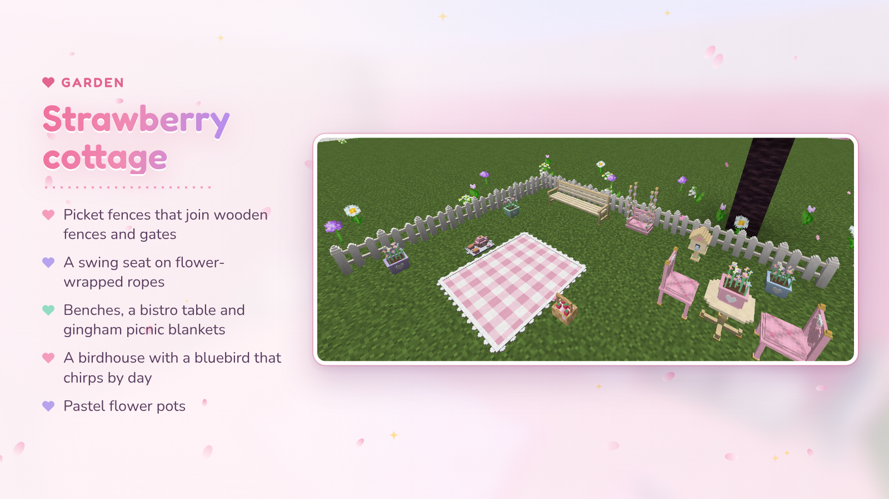

| Piece | What it does |
| --- | --- |
| **Garden Bench** | Sit. Benches side by side join like sofas |
| **Flower Pot** | A pastel pot of flowers |
| **Birdhouse** | A bluebird on the perch that chirps now and then in the daytime |
| **Picket Fence** | A real fence: it joins wooden fences and gates and holds leads. The recipe makes 3 |
| **Outdoor Table** | A round bistro table; decorations sit on it |
| **Picnic Blanket** | Gingham with scalloped white edges; blankets join like rugs |
| **Swing Seat** | Two blocks tall, on flower-wrapped ropes. Sit |

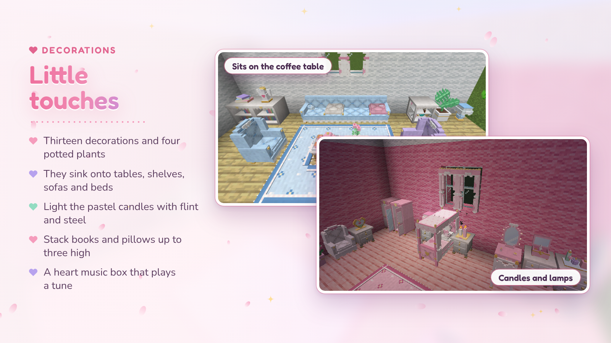

- **Potted plants:** Monstera, Rose Bush, Lavender and Cherry Blossom.
- **Decorations:** Book Stack (stack 3), Rose Vase, Tulip Vase, Pastel Candles, Perfume Bottles, Heart Music Box, Teddy Bear, Bunny Plush, Cupcake Stand, Heart Photo Frame, Ribbon Gift Box, Strawberry Basket and Angel Figurine.
- Decorations, lamps, tea sets, jewelry boxes and pillows **sink onto whatever they stand on**: a bedside table, a vanity, a dining table, a coffee table, a sofa seat, a bed or a vanilla slab. No more floating vases. Take the surface away and they settle back.
- **Pastel Candles** light with flint and steel (light 12) and snuff out with an empty hand. The **Heart Music Box** plays a tune when you click it.

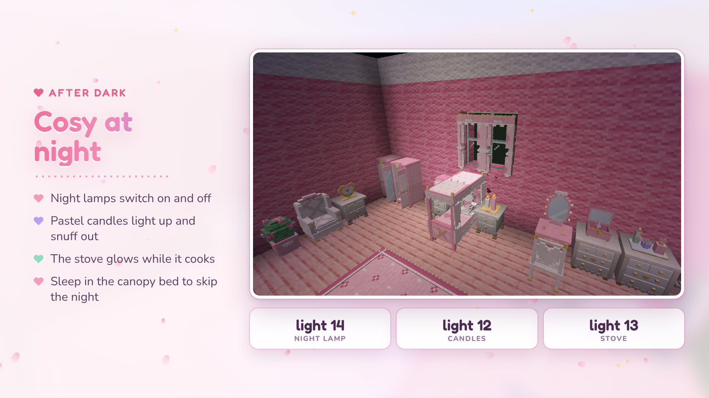

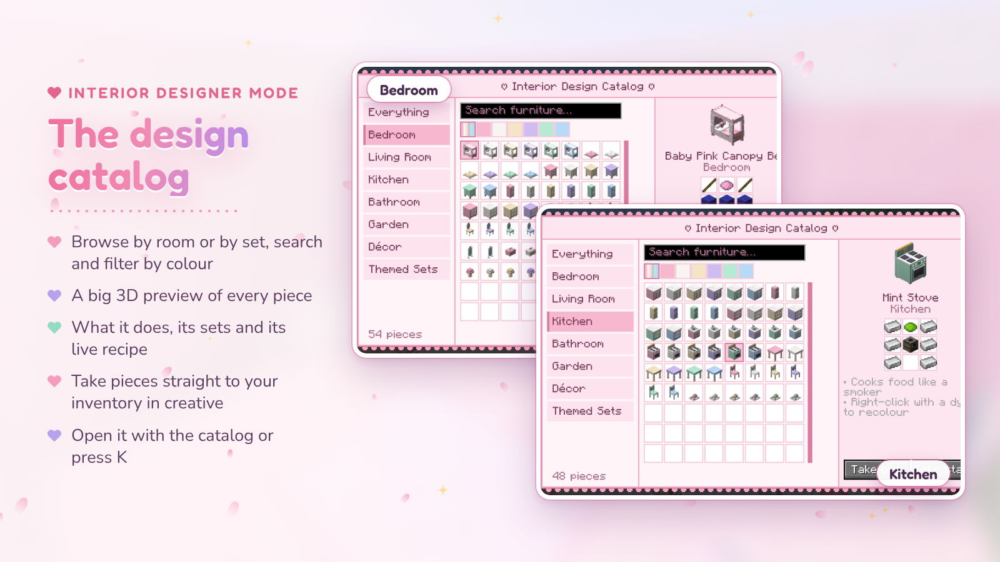

Every player gets an **Interior Design Catalog** on their first join. Right-click it, or press **K**.

- Browse by room or by set, **search by name** and filter by colour.
- Pick a piece to see a big 3D preview, what it does, which sets it belongs to and its **live crafting recipe**.
- In creative, *Take one*, *Take a stack* and *Take the whole set* put pieces straight into your inventory.
- Lost it? Craft another from a book and pink dye.

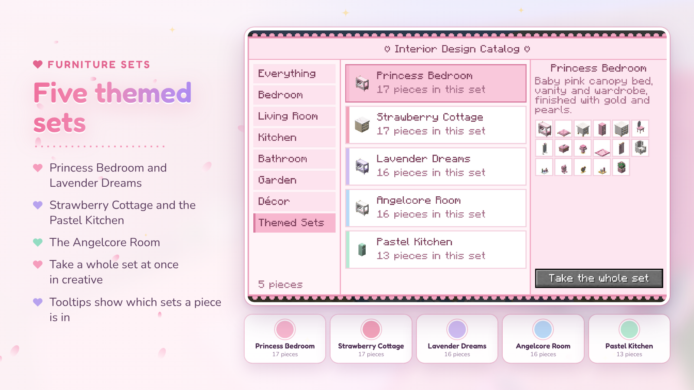

| Set | Pieces | The look |
| --- | --- | --- |
| **Princess Bedroom** | 17 | Baby pink canopy bed, vanity and wardrobe, finished with gold and pearls |
| **Strawberry Cottage** | 17 | Cream and pink cottage kitchen and garden with gingham picnics and berry baskets |
| **Lavender Dreams** | 16 | A sleepy lilac bedroom and bath scented with potted lavender |
| **Angelcore Room** | 16 | Cloud white and sky blue, with angels, candles and soft lace |
| **Pastel Kitchen** | 13 | A rainbow of pastel appliances: mint fridge, baby blue stove, cream counters |

Each piece's tooltip lists the sets it belongs to.

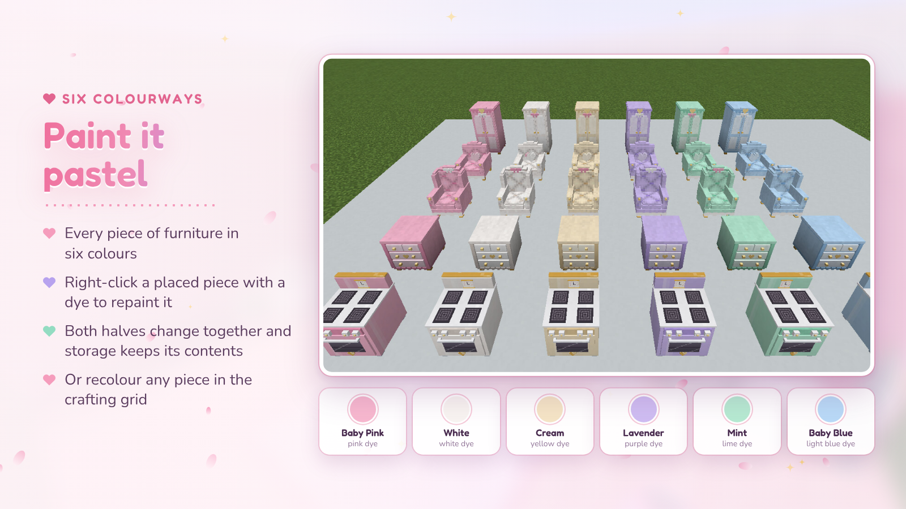

| Colourway | Dye |
| --- | --- |
| Baby Pink | Pink dye |
| White | White dye |
| Cream | Yellow dye |
| Lavender | Purple dye |
| Mint | Lime dye |
| Baby Blue | Light blue dye |

- **Right-click any placed piece with one of these dyes** to repaint it. Both halves of two-block pieces change together, and storage keeps its contents.
- In the crafting grid, any colour of a piece plus a dye gives that colour.

Every furniture recipe uses vanilla materials plus the colour's dye, and **every recipe is unlocked in your recipe book when you join**. The catalog shows each one, with the ingredients cycling through their options.

| Piece | Made from |
| --- | --- |
| Canopy Bed | Sticks, wool and planks |
| Decorative Pillows ×2 | A feather and wool |
| Bedside Table | Planks, a chest and sticks |
| Wardrobe | Planks and two chests |
| Dresser | Planks and a chest |
| Vanity Table | A glass pane, planks and sticks |
| Standing Mirror | Sticks and glass panes |
| Jewelry Box | Gold nuggets, planks and a chest |
| Night Lamp | Wool, a torch and a gold nugget |
| Sofa / Armchair | Wool and planks |
| Coffee Table | Planks and gold nuggets |
| Bookshelf | Planks and books |
| Display Cabinet | Planks and glass panes |
| Rug ×2 | Carpets |
| Curtains | Sticks and wool |
| Kitchen Cabinet / Counter | Quartz and planks (the cabinet also takes a chest) |
| Refrigerator | Iron ingots and a chest |
| Kitchen Sink | Quartz, a bucket and planks |
| Stove | Iron ingots and a smoker |
| Dining Table / Chair | Planks and sticks |
| Tea Set | Clay balls and gold nuggets |
| Bathtub / Bathroom Sink | Quartz |
| Wall Mirror | Planks and a glass pane |
| Bathroom Cabinet | Planks, a glass pane and a chest |
| Towel Rack | Iron nuggets and wool |
| Soap Dispenser | An iron nugget and clay balls |
| Garden Bench | Sticks and planks |
| Flower Pot | Small flowers and clay balls |
| Birdhouse | Planks and a stick |
| Picket Fence ×3 | Sticks and planks |
| Outdoor Table | Planks and iron nuggets |
| Picnic Blanket ×2 | Carpets and white wool |
| Swing Seat | String and planks |

The plants and decorations are made from what they look like: a rose bush in a flower pot, candles and a gold nugget, a note block for the music box, sugar, eggs and quartz for the cupcake stand, and so on.

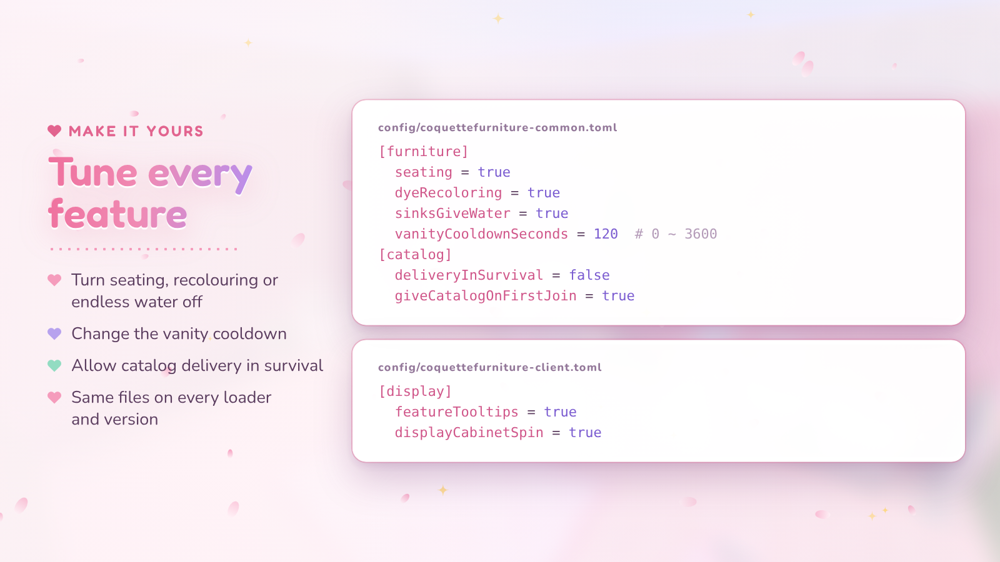

`config/coquettefurniture-common.toml` holds the server rules:

- **furniture:** `seating`, `dyeRecoloring`, `sinksGiveWater`, `vanityEffect`, `vanityCooldownSeconds` (120), `bathRegeneration`, `teaSetPoursTea`, `jewelryBoxMelodies` and `bookshelfEnchanting`.
- **catalog:** `deliveryInSurvival` (off, so taking pieces from the catalog is creative only), `giveCatalogOnFirstJoin` and `unlockAllRecipes`.

`config/coquettefurniture-client.toml` turns the feature tooltips, the set tooltips, birdhouse chirps and the spinning display cabinet items on or off.

The files and keys are the same on every loader and Minecraft version.

- **239 blocks** in two creative tabs, **Coquette Furniture** and **Coquette Décor**.
- Every piece is **waterloggable**, breaks into one item (two-block pieces drop once), and storage spills its contents when broken.
- Item tooltips list what each piece does and which sets it belongs to.
- Two-block pieces need the second space free: beds and bathtubs extend away from you, tall pieces upward.

| Minecraft | Loader | Java | Also install |
| --- | --- | --- | --- |
| 1.20.1 | Forge 47 or newer | 17+ | Nothing |
| 1.20.1 | Fabric (Loader 0.15+) | 17+ | [Fabric API](https://www.curseforge.com/minecraft/mc-mods/fabric-api) |
| 1.21.1 | NeoForge 21.1 or newer | 21+ | Nothing |
| 1.21.1 | Fabric (Loader 0.15+) | 21+ | [Fabric API](https://www.curseforge.com/minecraft/mc-mods/fabric-api) |
| 26.2 | NeoForge 26.2 | 25+ | Nothing |
| 26.2 | Fabric (Loader 0.15+) | 25+ | [Fabric API](https://www.curseforge.com/minecraft/mc-mods/fabric-api) |
| 26.3 | NeoForge 26.3 | 25+ | Nothing |
| 26.3 | Fabric (Loader 0.15+) | 25+ | [Fabric API](https://www.curseforge.com/minecraft/mc-mods/fabric-api) |

- Install Coquette Furniture (plus Fabric API on Fabric) on **both the server and every client**.
- Coquette Furniture is a mod. It does not work as a Paper, Spigot or Folia plugin.

**Does it need any other mod?**
No library mods. On Fabric you need Fabric API, like most Fabric mods.

**Can I get furniture from the catalog in survival?**
Not by default: in survival the catalog shows you each recipe instead. A server can set `deliveryInSurvival = true` in `coquettefurniture-common.toml`.

**Why does my vase float above the rug?**
Rugs and picnic blankets behave like vanilla carpet, so anything placed on top goes in the block above. Lay rugs in open floor space, and set decorations on tables, shelves and counters, where they sink down to sit on top.

**I can't click a decoration on my coffee table.**
A decoration that sank onto a low surface sits mostly inside the block below. Aim at its upper half, or stand closer.

**Is there a Fabric or NeoForge version?**
Yes. Coquette Furniture runs on Forge and Fabric for 1.20.1, and on NeoForge and Fabric for 1.21.1, 26.2 and 26.3. Every version has the same furniture, catalog and config.

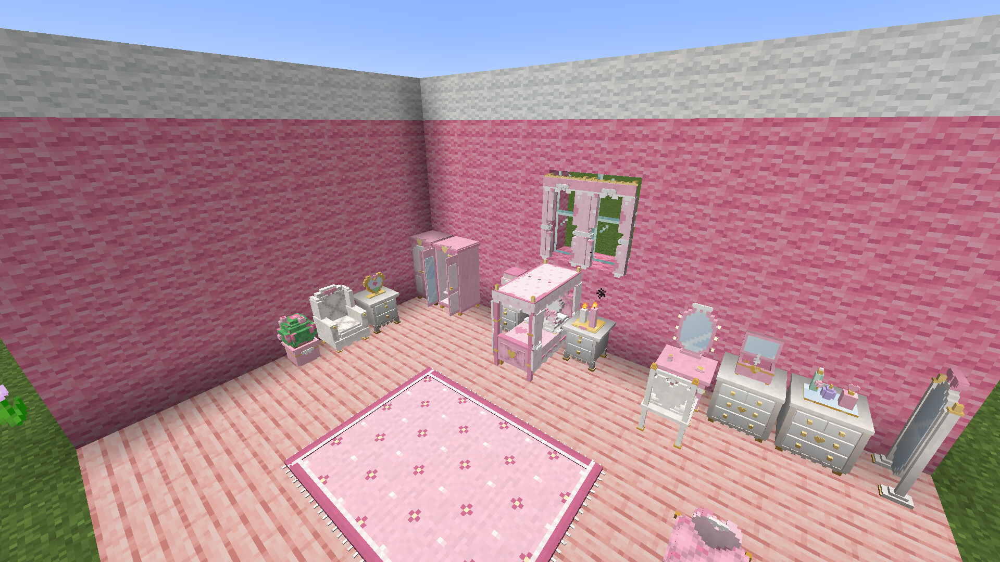

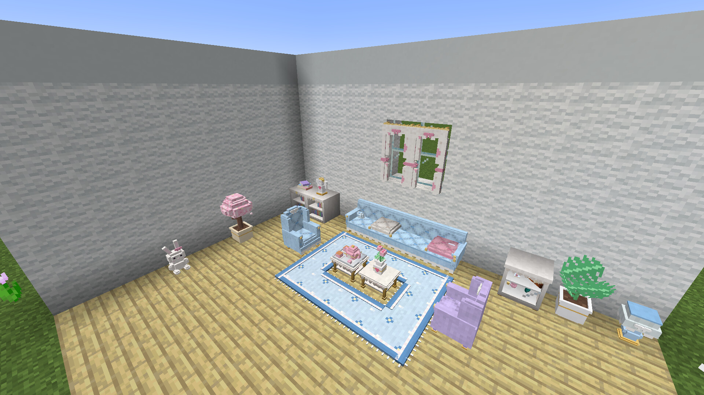

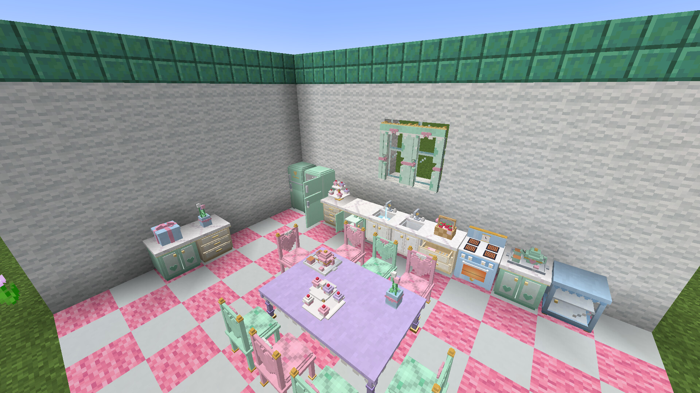

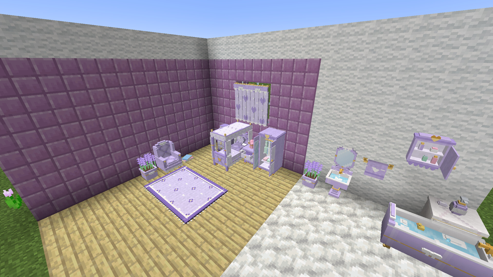

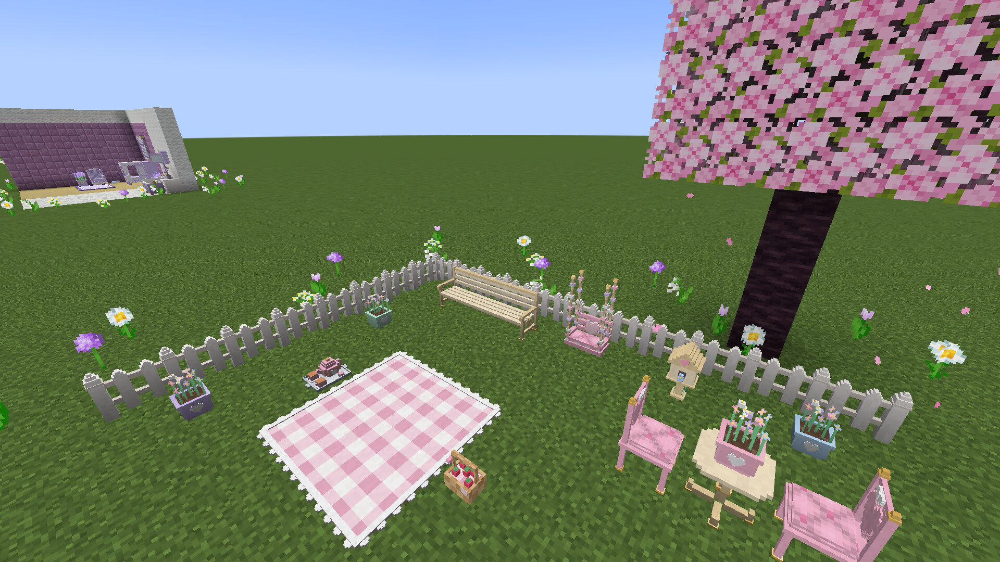

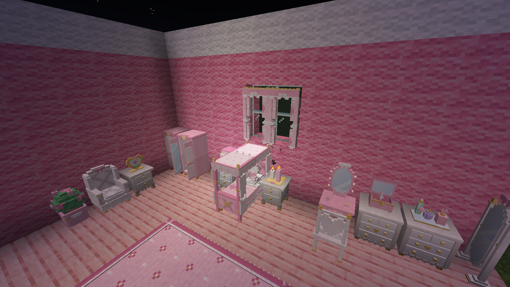

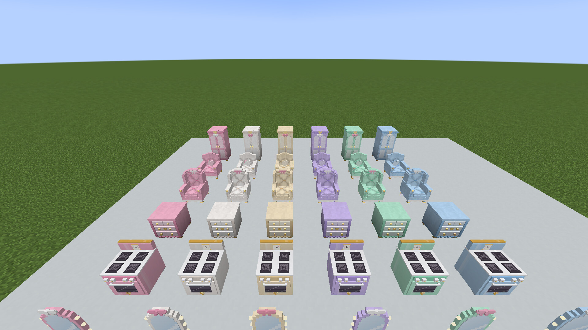

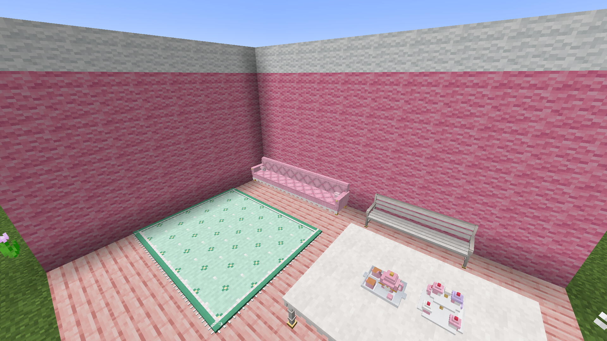

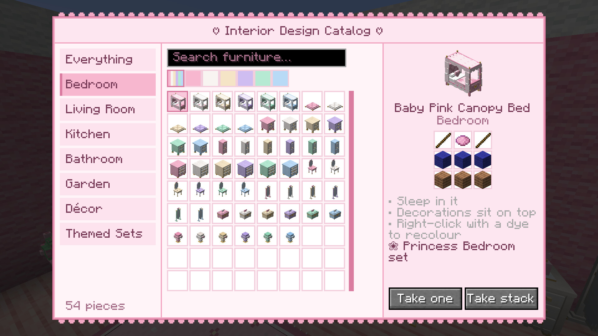

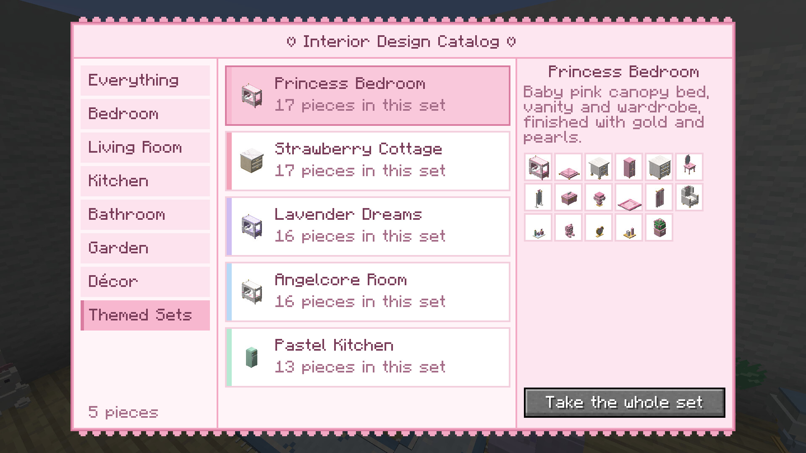

---

Coquette Furniture is made by Sugarplum Studios. All rights reserved. The Fredoka and Nunito fonts used in this artwork are licensed under the SIL Open Font License 1.1.

---

### More from NightBeam Studio

- **[Remnants: Ashen Legacy](https://www.curseforge.com/minecraft/modpacks/remnants-ashen-legacy)**: the story-driven soulslike RPG modpack built on NightBeam's mods
- **[Premium server plugins](https://nightbeam.dev/store)**: anti-cheat, ranked PvP, SMP setups and more on BuiltByBit
- **[NightBeam Pro](https://nightbeam.dev/memberships)**: the model library and NightBeam Forge credits, from $5 a month
- **[Discord](https://discord.gg/TJc3CxR4jK)**: support, bug reports, suggestions and early looks
- **[Support NightBeam](https://nightbeam.dev/support)**: help keep every mod free

**Follow:** [YouTube](https://www.youtube.com/@nightbeamstudio) · [Instagram](https://www.instagram.com/nightbeamstudio/) · [X](https://x.com/NightBeamLLC) · [Facebook](https://www.facebook.com/profile.php?id=61574823331471)
